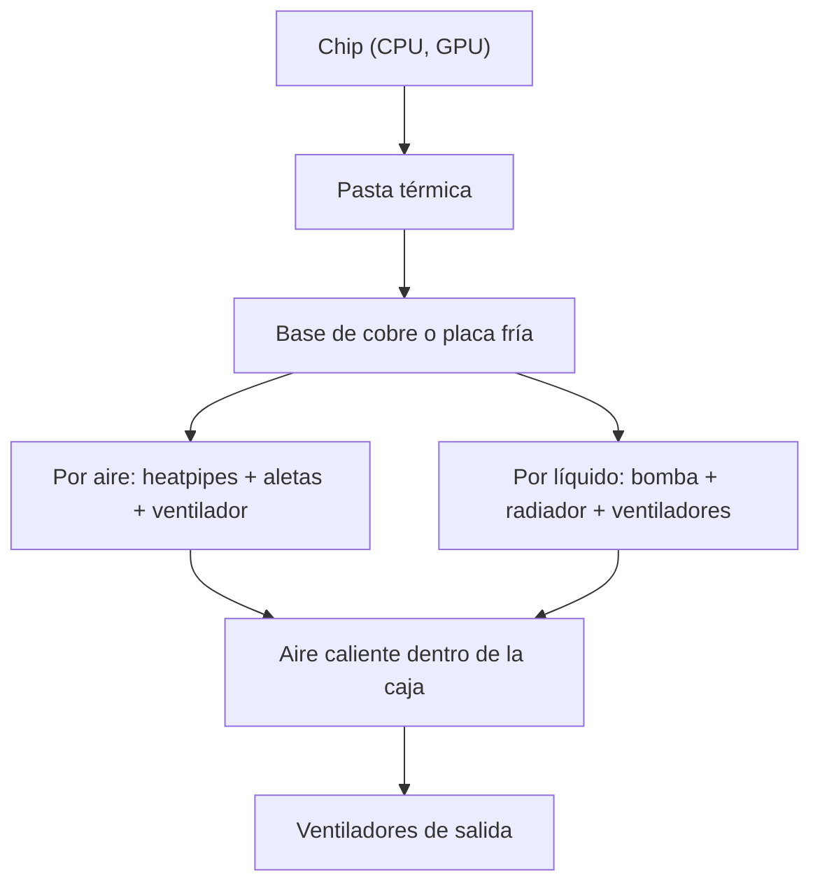

# Caja y refrigeración

Sheila Muñoz Matias y Loli joya  · 1.º DAW · Presentación: <https://canva.link/5go5luh37mesign>

## 1. Qué es y qué función cumple

El ordenador convierte toda la energía que consume en calor, sobre todo en la CPU, la GPU y las memorias. La refrigeración evita que ningún componente supere su temperatura máxima de trabajo.

- **Caja (chasis):** aloja y protege los componentes, y tiene huecos para ventiladores y rejillas por donde entra aiure frío y sale el caliente.
- **Disipador:** bloque de metal con aletas que recoge el calor del chip y lo reparte al aire.
- **Pasta térmica:** crema que rellena el hueco entre la CPU y el disipador.
- **Ventiladores:** empujan aire por las aletas y por dentro de la caja.
- **AIO:** refrigeración líquida compacta que lleva el calor a un radiador.

**Si falla:** la CPU se calienta, baja su rendimiento para enfriarse y, si sigue subiendo, el equipo se apaga.

## 2. Cómo funciona

El calor viaja del chip al aire de la habitación en 4 pasos:

1. **Conducción:** el chip pasa el calor al metal a través de la pasta térmica. Es el paso más sensible a un mal montaje.
2. **Transporte:** en aire, los *heatpipes* (tubos con fluido que se evapora y condensa) llevan el calor a las aletas; en una AIO, la bomba mueve el líquido hasta el radiador.
3. **Convección forzada:** los ventiladores empujan aire por las aletas o el radiador y este se lleva el calor.
4. **Expulsión:** el aire caliente debe salir de la caja; si se queda dentro, sube la temperatura de todo.

Los dos caminos acaban en el aire de la caja. El eslabón más débil (mal contacto, poca salida de aire) marca la temperatura final.

## 3. Calor y TDP

Todo componente disipa en calor la potencia eléctrica que consume: a más vatios, más calor que retirar. El **TDP** (*Thermal Design Power*, en W) es la potencia térmica de referencia con la que el fabricante pide dimensionar el disipador. Un procesador de 65 W de TDP necesita un sistema capaz de retirar al menos esa potencia. Pero el TDP es un dato de ficha y no la potencia real: en turbo, el consumo puede ser mucho mayor.

## 4. Características, unidades y cómo se miden

| Característica | Unidad | Qué indica y cómo se obtiene |
|---|---|---|
| TDP | W | Potencia térmica de referencia. No se mide: lo da el fabricante. |
| PBP y MTP | W | Potencia base y máxima en turbo (Intel). Vienen en la ficha. |
| PPT | W | Límite real de potencia del paquete (AMD). Se ve en la BIOS o en Ryzen Master. |
| Temperatura de CPU | ºC | Estado térmico actual. La miden sensores del chip; se lee en la BIOS. |
| Resistencia térmica | ºC/W | Grados que sube el chip por vatio (menos es mejor). Se calcula: (T chip − T ambiente) / W. |
| Velocidad de giro | RPM | Vueltas por minuto. La placa base cuenta la señal del ventilador. |
| Ciclo de trabajo PWM | % | Fracción de tiempo con señal activa; fija la velocidad. Lo genera la placa base. |
| Dimensiones | mm | Altura del disipador y tamaño del radiador. Se compara con la caja. |

## 5. Componentes de la refrigeración

### Disipadores

Un disipador tiene una **base** que toca el chip, **heatpipes** que transportan el calor y **aletas** que lo ceden al aire. Funciona por conducción (base y tubos) y convección (aletas y ventilador). Los materiales habituales son:

- **Cobre:** conduce mejor el calor, pero pesa más y es más caro. Se usa en la base y los heatpipes.
- **Aluminio:** más ligero y barato, conduce peor. Se usa en las aletas.

### Pasta térmica

Rellena las microirregularidades entre la CPU y el disipador, donde el aire aislaría el calor.

- **Tipos:** de silicona o cerámica (no conductoras eléctricamente, las más seguras), con partículas metálicas como la plata (mejor rendimiento) y **metal líquido** (el mejor, pero conduce la electricidad y no debe usarse sobre aluminio ni cerca de circuitos).
- **Dónde:** entre la tapa metálica de la CPU y la base del disipador o la placa fría.
- **Cuánto:** una capa fina, como un grano de arroz en el centro; el exceso no mejora nada y puede ensuciar.

### Ventiladores

Partes: **aspas** (rotor), **motor**, **rodamiento**, **marco** y **conector**. Hay dos medidas clave: el **caudal** (CFM, aire que mueve) y la **presión estática** (mmH₂O, capacidad de empujar aire contra una resistencia, como un radiador o un filtro). Por eso, para radiadores importa más la presión estática.

- **Tipos de control:** de 3 pines (control por voltaje, DC) y de 4 pines (**PWM**: la placa envía una señal con un ciclo de trabajo en % que ajusta la velocidad sin cambiar el voltaje).
- **Tipos de aspas:** de alto caudal (para cajas y espacios abiertos) y de alta presión estática (para radiadores y disipadores).

### Refrigeración líquida AIO

*All-In-One*: circuito cerrado y precargado. Sus partes son la **placa fría** (sobre la CPU), la **bomba**, los **tubos**, el **radiador**, los **ventiladores** y el **líquido refrigerante**. La bomba mueve el líquido, que absorbe el calor en la placa y lo cede al radiador, donde los ventiladores lo enfrían.

### Flujo de aire en la caja

El aire frío entra por delante y por abajo, y el caliente sale por detrás y por arriba, porque el aire caliente sube. Según la relación entre entrada y salida hay tres tipos:

- **Presión positiva:** entra más aire del que sale, y entra menos polvo.
- **Presión negativa:** sale más aire del que entra, y el polvo entra por las rendijas.
- **Equilibrada:** entrada y salida similares.

## 6. Tipos de refrigeración y modelo comercial

**Disipador de aire:** sin bomba ni fugas, duradero y barato, pero grande y pesado (puede chocar con la RAM o la tapa de la caja).

**AIO (120 a 420 mm):** rinde muy bien con CPU potentes y libera espacio en el socket, pero la bomba puede fallar, es más cara y necesita hueco para el radiador.

**Pasivo:** silencioso, pero solo vale para CPU de muy bajo consumo. **Circuito custom:** máximo rendimiento y estética, pero caro, con mantenimiento y riesgo de fugas.

### Modelo real: Arctic Liquid Freezer III 360 A-RGB

| Apartado | Especificación |
|---|---|
| Sockets | AMD AM5/AM4 · Intel LGA1851, LGA1700 |
| Ventiladores | 3 × ARCTIC P14 PWM A-RGB, 200–2000 RPM |
| Caudal / presión estática | 48,82 CFM / 1,85 mmH₂O |
| Ventilador VRM | 400–2500 RPM (PWM) |
| Bomba | 800–2800 RPM (PWM), hasta 4,2 W (0,35 A × 12 V) |
| Radiador | 398 × 120 × 38 mm |

**Interpretación:** es compatible con los sockets actuales de AMD e Intel. La bomba regulable por PWM permite equilibrar ruido y rendimiento. La presión estática alta es la adecuada para empujar aire por un radiador, y los 38 mm de grosor hay que comprobarlos contra la caja.

## 7. Averías y errores típicos

Casi siempre no son piezas rotas, sino mal contacto, mala conexión o mal flujo de aire. Antes de cambiar nada, mira temperaturas y RPM en la BIOS.

| Síntoma | Causa probable | Solución |
|---|---|---|
| CPU a 90 ºC o más en segundos | Film de plástico sin quitar, soporte mal apretado o poca/mucha pasta | Reinstalar con presión uniforme |
| Temperatura alta y estable | Filtros o radiador con polvo, caja sin salida de aire | Limpiar y revisar el flujo |
| Peor rendimiento tras años | Pasta térmica reseca | Limpiar con alcohol isopropílico y repetir la pasta |
| Ventilador ruidoso o parado | Rodamiento gastado, polvo o cable en las aspas | Limpiar o sustituir |
| No sigue la curva de la BIOS | Header de 3 pines o modo PWM/DC mal elegido | Fijar el modo correcto |
| Error de ventilador al arrancar | Bomba en el header equivocado o RPM bajo el mínimo | Usar el header de AIO/bomba |
| Gorgoteo en AIO | Aire atrapado en la bomba | Montar el radiador más alto que la bomba |
| Luz o ventilador no funcionan | Mezcla de A-RGB 5 V con RGB 12 V | Respetar la tensión de cada conector |

 Noctua advierte de que conectar 12 V o 24 V al pin de control PWM estropea el ventilador de inmediato.

**Errores al elegir:** fiarse solo del TDP, no medir el espacio (caja, RAM, gráfica), no revisar el socket, usar metal líquido sobre aluminio, o elegir ventilador por caudal en vez de por presión estática en un radiador.

**Errores al instalar:** apretar el soporte de golpe en vez de gradual y en cruz, poner demasiada pasta, dejar los ventiladores todos entrando o todos sacando, dejar cables que choquen con las aspas, y conectar la bomba a un header regulado por temperatura.

## 8. Fuentes y uso de IA

**Fuentes:**
- Guru3D, reseña del Arctic Liquid Freezer III 360 A-RGB: <https://www.guru3d.com/review/arctic-liquid-freezer-iii-360-argb-cooler-review/page-2/>
- Profesional Review, ventiladores de 3 vs 4 pines: <https://www.profesionalreview.com/2024/08/25/ventiladores-3-pines-vs-4-pines/amp/>
- Geeknetic, ventajas del control PWM: <https://www.geeknetic.es/Guia/2717/Ventajas-de-los-Ventiladores-con-control-PWM-de-4-pines.html>
- Corsair, presión positiva vs negativa: <https://www.corsair.com/lm/es/explorer/diy-builder/blogs/positive-pressure-vs-negative-pressure-which-is-best-for-a-gaming-pc/>
- CNX Software, TDP vs PBP: <https://www.cnx-software.com/2022/01/08/tdp-vs-pbp-thermal-design-power-vs-pbp-processor-base-power-differences/>
- Intel, *4-Wire PWM Controlled Fans*: <https://www.mikrocontroller.net/attachment/670442/4-Wire_PWM_Controlled_Fans.pdf>

**Uso de IA:** hemos usado Claude para buscar fuentes, proponer la estructura y redactar un primer borrador, que hemos revisado, corregido y recortado.

## 9. Preguntas tipo test

**Bloque 1: conceptos y características**

**1. ¿Qué función cumple la pasta térmica?**
- A) Enfriar de forma activa la CPU con líquidos.
- B) Rellenar el hueco de aire entre CPU y disipador; basta una capa fina como un grano de arroz.
- C) Eliminar la necesidad de ventiladores.
- D) Proteger la caja del polvo.

 **Respuesta: B.** Entre la CPU y el disipador quedan huecos microscópicos llenos de aire, y el aire conduce muy mal el calor. La pasta los rellena y mejora la transferencia. No enfría por sí sola (A), no sustituye a los ventiladores (C) y no tiene nada que ver con el polvo (D).

**2. ¿Qué indica el PPT?**
- A) Un dato fijo de Intel que no se puede modificar.
- B) Las RPM de la bomba.
- C) El límite real de potencia del paquete; se consulta en la BIOS o en Ryzen Master.
- D) Los grados que sube el chip por vatio.

 **Respuesta: C.** El PPT es el límite real de potencia del procesador, medido en W. Se ve en la BIOS o en Ryzen Master, el programa de AMD. La A confunde el PPT con el TDP (que sí es un dato de ficha), la B habla de RPM (que son del ventilador o la bomba) y la D describe la resistencia térmica (ºC/W).

**3. ¿Qué inconveniente tiene un disipador de aire frente a una AIO?**
- A) Riesgo elevado de fugas.
- B) Poca durabilidad por tener muchas piezas móviles.
- C) Requiere mantenimiento constante y metal líquido.
- D) Es grande y pesado y puede chocar con la RAM o la tapa de la caja.

 **Respuesta: D.** Su desventaja es el tamaño y el peso, que pueden provocar choques físicos con la RAM o con la tapa de la caja. La A es un problema de las AIO y de los circuitos custom, no del aire, que no lleva líquido. La B es falsa: el disipador de aire solo tiene el ventilador como pieza móvil y es muy duradero. La C es falsa porque no necesita mantenimiento constante ni metal líquido.

**4. ¿En qué parámetro hay que fijarse para un ventilador de radiador?**
- A) Caudal de aire en lugar de presión estática.
- B) Presión estática en lugar de caudal de aire.
- C) Que sea solo de 3 pines.
- D) Que las aspas midan 40 mm.

 **Respuesta: B.** Un radiador tiene muchas aletas muy juntas que ofrecen resistencia al paso del aire. Para empujar aire a través de ellas hace falta presión estática. El caudal importa más en espacios abiertos, como el flujo general de la caja. Por eso la A es justo el error que se señala en "errores al elegir". Las C y D no tienen que ver con el rendimiento en un radiador.

**Bloque 2: funcionamiento, averías y ficha técnica**

**5. ¿En qué consiste el "Transporte" en una AIO?**
- A) La bomba hace circular el líquido caliente desde la placa fría hasta el radiador.
- B) Los ventiladores expulsan el aire fuera de la habitación.
- C) El líquido se evapora en las aletas.
- D) El chip pasa el calor a la placa fría por conducción.

 **Respuesta: A.** El paso 2 del funcionamiento es el transporte, y en una AIO lo hace la bomba moviendo el líquido hasta el radiador. La B corresponde a la expulsión (paso 4). La C describe los heatpipes de un disipador de aire, no una AIO. La D es la conducción (paso 1).

**6. Si la CPU llega a 90 ºC en segundos de carga, ¿cuál es la causa más probable?**
- A) Filtros ligeramente sucios.
- B) Evaporación lenta del líquido.
- C) Mal contacto: film sin quitar, soporte mal apretado o pasta mal aplicada.
- D) Presión de aire positiva.

**Respuesta: C.** Una subida tan rápida indica que el calor no pasa del chip al disipador, es decir, falla la conducción. La A (poco flujo de aire) hace que la temperatura suba despacio y se estabilice alta. La B ocurre con los años, no en segundos. La D no es un problema: la presión positiva incluso reduce el polvo.

**7. ¿Qué rango de giro tiene la bomba del Liquid Freezer III 360?**
- A) 200–2000 RPM.
- B) 400–2500 RPM.
- C) 800–2800 RPM (regulable por PWM).
- D) Fija a 3000 RPM.

 **Respuesta: C.** Es el dato de la ficha técnica. La A corresponde a los ventiladores P14 (200–2000 RPM) y la B al ventilador VRM (400–2500 RPM). La D es falsa, porque la bomba es regulable por PWM.

**8. Según Noctua, ¿qué pasa si se conectan 12 V al pin de control de un ventilador PWM?**
- A) Aumenta su caudal un 50 % de forma segura.
- B) Se estropea de inmediato.
- C) La BIOS lo pasa a modo DC.
- D) La luz A-RGB cambia de color.

 **Respuesta: B.** El pin de control del PWM solo admite una señal de control de baja tensión. Meterle 12 V o 24 V daña el ventilador al instante, tal como advierte Noctua en su documento técnico. Las otras opciones son inventadas: ni mejora el rendimiento, ni la BIOS cambia de modo, ni cambia el color de la luz.

**Respuestas:** 1-B · 2-C · 3-D · 4-B · 5-A · 6-C · 7-C · 8-B :
