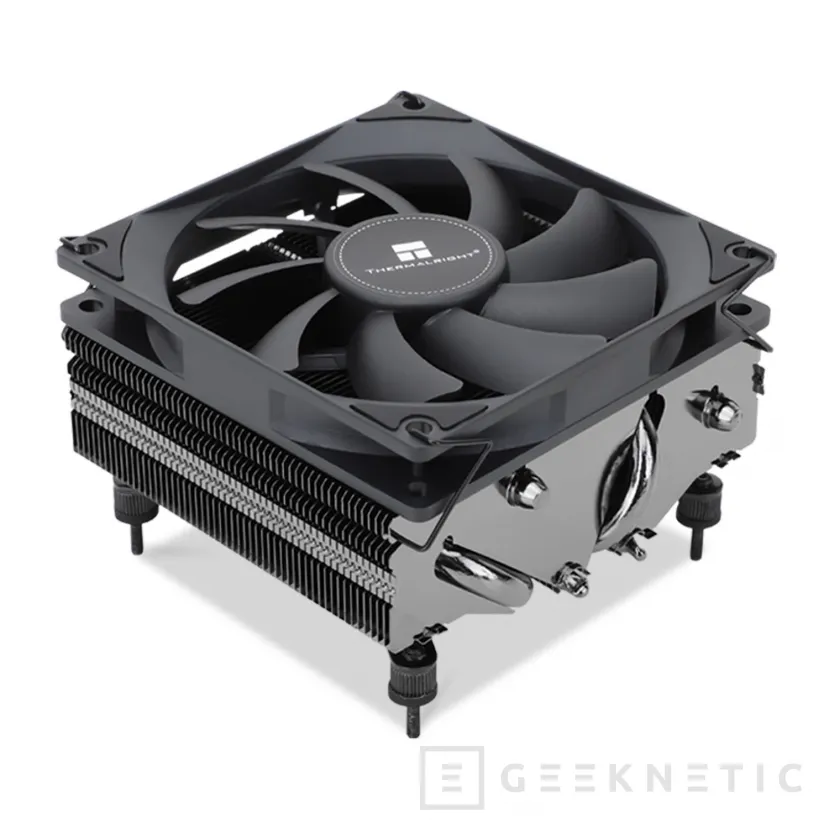
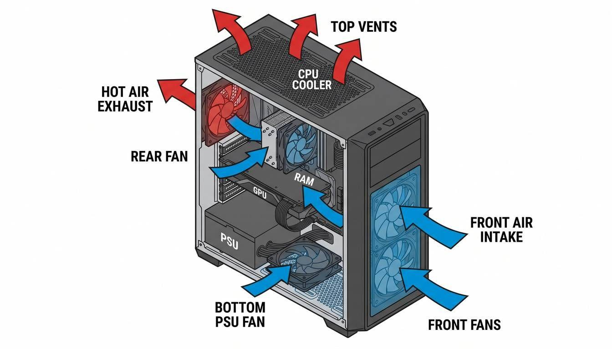
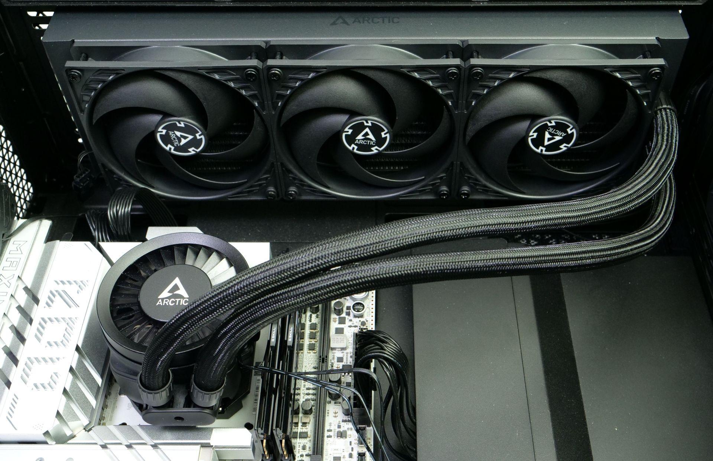
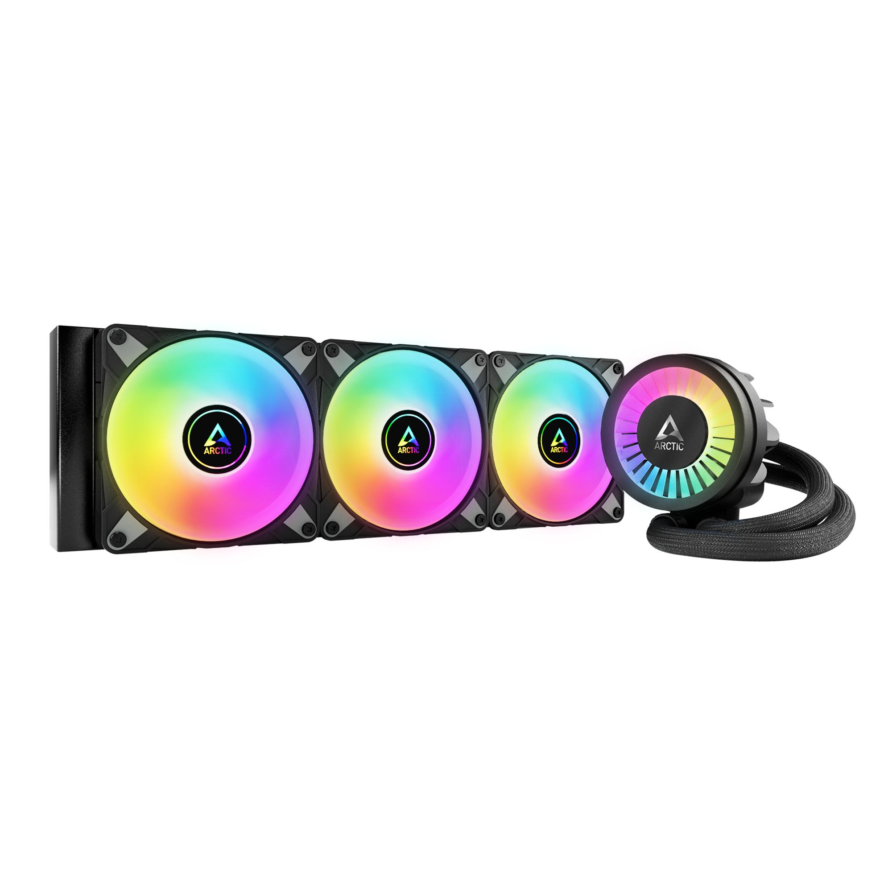

# Caja y refrigeración

**Realizado por:** Sheila Muñoz Matias y Loli Joya

## 1. Qué es y qué función cumple el sistema

El ordenador genera mucho calor, sobre todo en la CPU, la GPU y las memorias, y la refrigeración evita que ningún componente supere su temperatura máxima [4].

- **Caja:** protege los componentes y tiene rejillas para que entre aire frío y salga el caliente.
- **Disipador:** bloque de metal con aletas que recoge el calor del chip y lo reparte al aire.
- **Pasta térmica:** crema entre CPU y disipador que rellena el hueco de aire, que conduce mal el calor. Basta una capa fina.
- **Ventiladores:** empujan aire por las aletas y por la caja.
- **AIO (líquida):** un líquido recoge el calor en una placa sobre la CPU y lo suelta en un radiador con ventiladores.

**Si falla:** la CPU se calienta, baja su rendimiento y, si sigue subiendo, el equipo se apaga.

*Figura 1: disipador de aire; el calor sube por los tubos hasta las aletas.*

## 2. Cómo funciona

El calor viaja del chip al aire en 4 pasos:

1. **Conducción:** el chip cede calor al disipador o a la placa fría a través de la pasta.
2. **Transporte:** los *heatpipes* (tubos con un fluido que se evapora y se condensa) llevan el calor a las aletas; en una AIO, la bomba mueve el líquido al radiador.
3. **Convección forzada:** los ventiladores empujan aire por las aletas o el radiador.
4. **Expulsión:** el aire caliente debe salir de la caja, o sube la temperatura de todo.

El eslabón más débil (mal contacto, poco aire) marca la temperatura final.

**Flujo de aire:** entra aire fresco por el frontal y la parte baja y sale por detrás y arriba [3][4]. Si entra más del que sale hay presión positiva (menos polvo); si no, negativa [3][5].

*Figura 2: el aire frío entra por delante y abajo y sale por detrás y arriba.*

## 3. Características y unidades

| Magnitud | Unidad | Qué indica y cómo se obtiene |
|---|---|---|
| **TDP** | W | Potencia térmica de referencia del fabricante; se lee en la ficha [6] |
| **PBP y MTP** | W | En Intel, potencia base y máxima en turbo; ficha [6] |
| **PPT** | W | En AMD, límite real de potencia; BIOS o Ryzen Master |
| **Temperatura CPU** | ºC | Estado térmico; sensores del chip, se lee en la BIOS |
| **Resistencia térmica** | ºC/W | Grados que sube el chip por vatio (menos es mejor); (T chip − T ambiente) / W |
| **Velocidad de giro** | RPM | Vueltas por minuto del ventilador o la bomba; BIOS o programa |
| **Ciclo PWM** | % | Fracción de tiempo con señal activa; a más %, más rápido gira [1][2] |
| **Caudal** | CFM | Aire por minuto (1 CFM ≈ 1,7 m³/h); ficha |
| **Presión estática** | mmH₂O | Fuerza para empujar aire contra una resistencia, como un radiador; ficha |
| **Ruido** | dB(A) | Nivel sonoro; +3 dB duplica la energía; ficha |
| **Dimensiones** | mm | Altura del disipador y tamaño del radiador; se comparan con la caja |

## 4. Tipos, evolución y estándares actuales

| Tipo | Funcionamiento | Ventajas | Inconvenientes |
|---|---|---|---|
| **Disipador de aire** | Base de cobre, *heatpipes* y aletas con ventilador | Sin bomba ni fugas, duradero, económico | Grande y pesado; puede chocar con RAM o tapa |
| **AIO (120 a 420 mm)** | Placa fría, bomba y radiador | Rinde con CPU potentes y libera el socket | La bomba puede fallar, más cara, necesita hueco |
| **Pasiva** | Solo aletas y flujo de la caja | Silencio total | Solo CPU de muy bajo consumo |
| **Circuito personalizado** | Bomba, depósito y radiadores a medida | Máximo enfriamiento y estética | Muy caro, mantenimiento y riesgo de fugas |

*Figura 3: AIO con placa fría, tubos y radiador; los ventiladores enfrían el líquido.*

**Evolución:** del disipador de aluminio pasivo se pasó al ventilador con cobre y *heatpipes*, y después a las AIO con radiadores de 120 a 420 mm.

**Estándares actuales:** sockets AM5 (AMD) y LGA1851 y LGA1700 (Intel), que mantienen los anclajes de AM4 y LGA1700; ventiladores de 120 y 140 mm con 4 pines y PWM a 25 kHz [7][8]; iluminación A-RGB de 5 V frente a RGB de 12 V, que no se pueden mezclar.

## 5. Modelo comercial real: Arctic Liquid Freezer III 360 A-RGB

*Figura 4: AIO de 360 mm con tres ventiladores y la bomba con el ventilador VRM encima.*

Según Guru3D [9], mejora a la serie anterior con bomba rediseñada y un ventilador sobre la bomba que enfría los VRM y la memoria. La elegimos por ser compatible con los sockets actuales y tener ficha pública.

| Característica | Dato |
|---|---|
| Sockets | AMD: AM5 y AM4. Intel: LGA1851 y LGA1700 |
| Ventiladores | 3 de 120 x 120 x 25 mm (P14 PWM A-RGB según la ficha), 200 a 2000 RPM |
| Caudal / presión estática | 48,82 CFM / 1,85 mmH₂O |
| Ventilador VRM | 400 a 2500 RPM, PWM |
| Bomba | 800 a 2800 RPM, PWM; hasta 4,2 W (0,35 A a 12 V) |
| Radiador | 398 x 120 x 38 mm |

Los 398 mm exigen soporte para radiador de 360 mm; los 38 mm obligan a comprobar el hueco con la RAM; y la presión estática alta empuja el aire por un radiador denso.

## 6. Averías típicas y errores al elegir o instalar

Casi siempre el fallo es mal contacto, mala conexión o poco aire. Antes de cambiar nada, mira la BIOS.

| Problema | Causa más probable | Solución |
|---|---|---|
| CPU a 90 ºC o más en segundos | Mal contacto: film sin retirar, soporte mal apretado, falta o exceso de pasta | Reinstalar con presión uniforme |
| Temperatura alta y estable | Polvo en filtros o radiador, o caja sin salida de aire | Limpiar y revisar la entrada y salida de aire |
| Peor con los años | Pasta reseca | Cambiarla (alcohol isopropílico) |
| Ventilador ruidoso o parado | Rodamiento gastado, polvo o cable en las aspas | Limpiar, revisar el cable o sustituirlo |
| No sigue la curva de la BIOS | Header de 3 pines con ventilador de 4, o modo PWM/DC mal elegido | Fijar el modo correcto [1][2] |
| Error de ventilador al arrancar | Bomba o ventilador en el header equivocado, o RPM bajas | Bomba en el header de bomba o AIO |
| Gorgoteo o peor rendimiento en una AIO | Aire en la bomba (si está en el punto más alto), o líquido evaporado con los años | Radiador más alto que la bomba; vigilar RPM |
| Iluminación o ventilador dejan de funcionar | A-RGB de 5 V mezclado con RGB de 12 V, o 12 V en el pin de control PWM | Respetar la tensión de cada conector |

El último caso es grave: Noctua advierte de que 12 V o 24 V en el pin de control del PWM pueden dañar el ventilador [8].

**Errores al elegir:** guiarse solo por el TDP; no medir si cabe en la caja, la RAM o la gráfica; no revisar el socket; usar metal líquido sobre aluminio; y elegir ventilador de radiador por caudal y no por presión estática.

**Errores al instalar:** apretar el soporte de golpe y no en cruz; poner demasiada pasta; no dejar vía de escape al aire (efecto horno); dejar cables que frenen el aire; y conectar la bomba a un header regulado por temperatura, que baja sus RPM.

## 7. Fuentes y uso de IA

1. [Ventiladores 3 vs 4 pines](https://www.profesionalreview.com/2024/08/25/ventiladores-3-pines-vs-4-pines/amp/)
2. [Control PWM de 4 pines](https://www.geeknetic.es/Guia/2717/Ventajas-de-los-Ventiladores-con-control-PWM-de-4-pines.html)
3. [Presión positiva y negativa](https://www.profesionalreview.com/2017/10/29/que-es-presion-positiva-y-negativa-de-aire-pc/amp/)
4. [Aire y rendimiento en PC](https://es.digitaltrends.com/computadoras/el-aire-es-el-mejor-secreto-para-mejorar-el-rendimiento-de-los-juegos-en-pc/)
5. [Presión positiva vs negativa, Corsair](https://www.corsair.com/lm/es/explorer/diy-builder/blogs/positive-pressure-vs-negative-pressure-which-is-best-for-a-gaming-pc/)
6. [TDP vs PBP](https://www.cnx-software.com/2022/01/08/tdp-vs-pbp-thermal-design-power-vs-pbp-processor-base-power-differences/)
7. [4-Wire PWM Controlled Fans](https://www.mikrocontroller.net/attachment/670442/4-Wire_PWM_Controlled_Fans.pdf)
8. [Noctua PWM white paper](https://cdn.noctua.at/media/Noctua_PWM_specifications_white_paper.pdf)
9. [Reseña Arctic Liquid Freezer III 360, Guru3D](https://www.guru3d.com/review/arctic-liquid-freezer-iii-360-argb-cooler-review/page-2/)

**Uso de IA:** usamos Claude para buscar fuentes, proponer la estructura y redactar un borrador, que luego revisamos y corregimos.

## 8. Preguntas tipo test

**1. ¿Qué función cumple la pasta térmica?**
- A) Enfriar la CPU con un líquido.
- B) Rellenar los huecos de aire entre CPU y disipador.
- C) Sustituir a los ventiladores.
- D) Evitar que entre polvo en el socket.

**Respuesta: B.** El aire de esos huecos conduce mal el calor y la pasta lo sustituye. La A, C y D no son su función.

**2. ¿Qué indica el PPT?**
- A) La potencia máxima en turbo de Intel.
- B) Las RPM de la bomba.
- C) El límite real de potencia de un procesador AMD.
- D) Los grados que sube el chip por vatio.

**Respuesta: C.** Se ve en la BIOS o Ryzen Master. La A es el MTP, la B son RPM y la D es la resistencia térmica.

**3. ¿Qué inconveniente tiene un disipador de aire frente a una AIO?**
- A) Tiene una bomba que puede fallar.
- B) Necesita líquido y puede tener fugas.
- C) Exige un hueco para el radiador.
- D) Es grande y pesado y puede chocar con la RAM o la tapa.

**Respuesta: D.** Las A, B y C son inconvenientes de la AIO: el aire no lleva bomba, líquido ni radiador.

**4. ¿En qué hay que fijarse al elegir un ventilador de radiador?**
- A) En el caudal, porque el radiador deja pasar mucho aire.
- B) En la presión estática, porque las aletas frenan el aire.
- C) Solo en las RPM máximas.
- D) En que tenga conector de 3 pines.

**Respuesta: B.** Las aletas oponen resistencia y hace falta presión para empujar el aire. El caudal importa más en la caja.

**5. ¿En qué consiste el "transporte" en una AIO?**
- A) La bomba mueve el líquido de la placa fría al radiador.
- B) Los ventiladores empujan aire por el radiador.
- C) El chip cede calor a la placa fría.
- D) El aire caliente sale por detrás de la caja.

**Respuesta: A.** Es el paso 2. La B es convección forzada (3), la C conducción (1) y la D expulsión (4).

**6. Si la CPU llega a 90 ºC en pocos segundos, ¿cuál es la causa más probable?**
- A) Filtros con polvo.
- B) Evaporación del líquido de la AIO.
- C) Mal contacto entre CPU y disipador, por ejemplo con un film sin quitar.
- D) Pasta reseca por los años.

**Respuesta: C.** Una subida tan rápida indica que el calor no pasa del chip al disipador. Las A, B y D tardan en notarse.

**7. Conectas la bomba de una AIO a un header regulado por la temperatura de la CPU. ¿Qué pasa en reposo?**
- A) Funciona mejor y hace menos ruido.
- B) Se estropea por falta de tensión.
- C) Nada: siempre gira igual.
- D) Baja mucho sus RPM y la CPU se calienta antes al cargarla.

**Respuesta: D.** Es el error de "bomba capada": con poco líquido circulando, el calor no se retira a tiempo.

**8. Según Noctua, ¿qué puede ocurrir al conectar 12 V al pin de control de un ventilador PWM?**
- A) Que se dañe, porque ese pin solo admite una señal de baja tensión.
- B) Que gire al máximo sin riesgo.
- C) Que la BIOS lo pase a modo DC.
- D) Nada, porque el pin está protegido.

**Respuesta: A.** El pin solo admite señal de control; 12 V puede dañar el ventilador.

**Respuestas:** 1-B · 2-C · 3-D · 4-B · 5-A · 6-C · 7-D · 8-A
