# SI · UT2 — Ficha de taller: montaje y revisión de un ordenador

## 1. Orden de trabajo

**Fecha:** 09/11/2026  **Puesto:** ____________________  **Equipo / etiqueta:** ____________________

**Integrantes del grupo (2 o 3):**

1. Nombre y apellidos: Sheila Muñoz Matías
2. Nombre y apellidos: Loli Joya Martín
3. Nombre y apellidos (si procede): __________________________________

> **Equipo A:** ordenador de prácticas utilizado para el montaje o la revisión. Puede estar averiado; no se exige que arranque.
>
> **Equipo B:** vuestro propio ordenador funcional. Se utiliza a partir del apartado 9 para analizar el arranque y el hardware desde Linux.

## 2. Recepción e inspección visual · Equipo A

**Trabajo previsto:**

- [X] Desmontaje y montaje
- [X] Revisión / diagnóstico
- [ ] Otro: ___________________________________

**Estado al recibirlo:**

- [ ] Completo
- [X] Faltan piezas
- [ ] Sucio
- [ ] Daños visibles

**Síntomas conocidos, piezas ausentes o daños observados:**

- Al ordenador de prácticas le faltaba el embellecedor, y tenía dentro de la caja un cable del panel frontal (SPEAKER) suelto, y ya teniendo colocado el SPEAKER en el panel frontal, es decir, había uno que sobraba dentro. Además en la parte de fuera de la caja, donde se encuentra la fuente de alimentación, le faltaban tornillos, tenía solamente 1 tornillo que lo sujetaba.

## 3. Seguridad y preparación · Equipo A

- [X] Equipo desconectado de la corriente y de los periféricos.
- [ ] Botón de encendido pulsado tras desconectar.
- [X] Superficie despejada y piezas organizadas.
- [X] Estado inicial y conexiones fotografiados.

**Herramientas utilizadas:** Las herramientas utilizadas para desmontar el ordenador y montarlo vuelta han sido: Destornillador de estrella y el plano (para quitarle los tornillos), brocha (para quitarle el polvo), pasta térmica (para añadirla entre la CPU y el disipador para que no haya mala conducción de calor), y el alcohol isopropílico (para limpiar la anterior pasta térmica que tenía la CPU).

**No abráis la fuente ni forcéis piezas.** Ante daños o baterías, avisad al profesor.

## 4. Componentes identificados · Equipo A

Anotad lo que podáis verificar. Si no se distingue, escribid «no identificado».

| Componente | Marca / modelo | Dato observado |
|---|---|---|
| Placa base | GA-H81m-Dev | |
| Procesador | Intel pentium | |
| RAM | Kingston | |
| Almacenamiento | Western Digital (wb) | |
| Fuente | Power man | |
| Disipador / ventilador | Intel | |
| Tarjetas / otros | No identificado | |

## 5. Conexiones y observaciones · Equipo A

Identificad y marcad las conexiones presentes y comprobadas:

- [X] Alimentación de la placa
- [X] Alimentación de la CPU
- [X] Ventilador de la CPU
- [X] Datos de almacenamiento
- [X] Alimentación del disco
- [X] Panel frontal

**¿Hay algún cable suelto, conector dañado o conexión que no sepáis identificar?**

- Lo único de cable suelto que hubo, era un cable que iba en el panel frontal, el SPEAKER, pero ya había uno colocado. Además habían algún que otro cable que no estaba conectado, ya que era adicional, por si habían más componentes de más.

**Fotografías de referencia (nombre de archivo o ubicación):**

________________________________________________________________________

No retiréis la CPU ni el disipador sin indicación del profesor. Si se retira el disipador, consultad sobre limpieza y pasta térmica antes de volver a instalarlo.

## 6. Registro del trabajo · Equipo A

Registrad únicamente lo que hayáis hecho; marcad **N/P** si no procede.

| Operación | Hecho | N/P | Foto / observaciones |
|---|:---:|:---:|---|
| Apertura y fotos iniciales | X | ☐ | 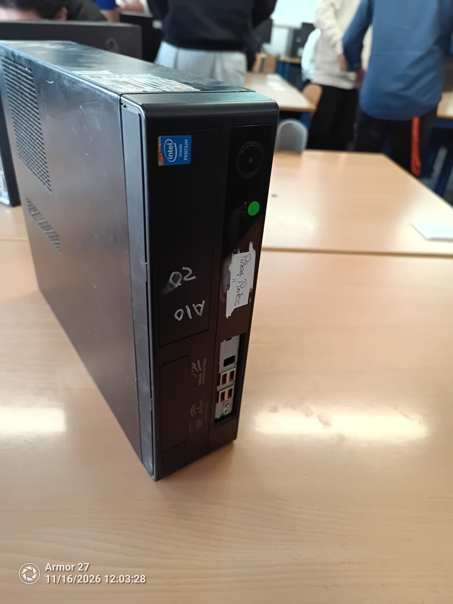 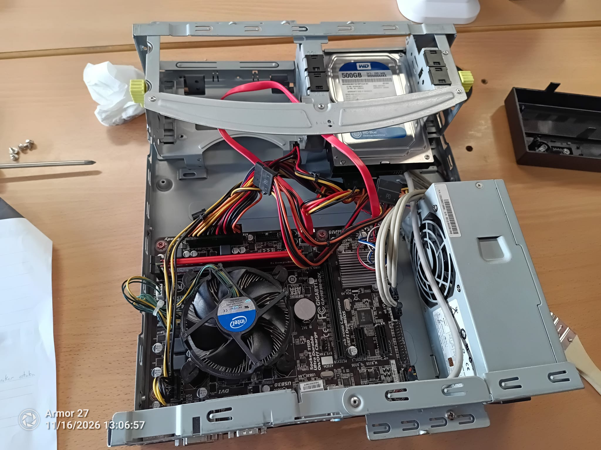 - Primero le quitamos los tornillos a la caja, al intentar abrirlo costo un poco |
| Desconexión y organización de cables | X | ☐ | 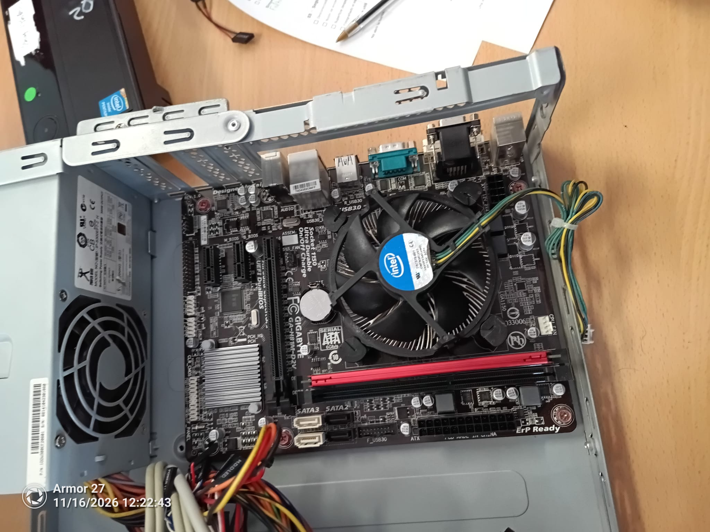 - Quitamos los cables y empezamos a quitar la placa base de la caja |
| Desmontaje / montaje de memoria | X | ☐ | 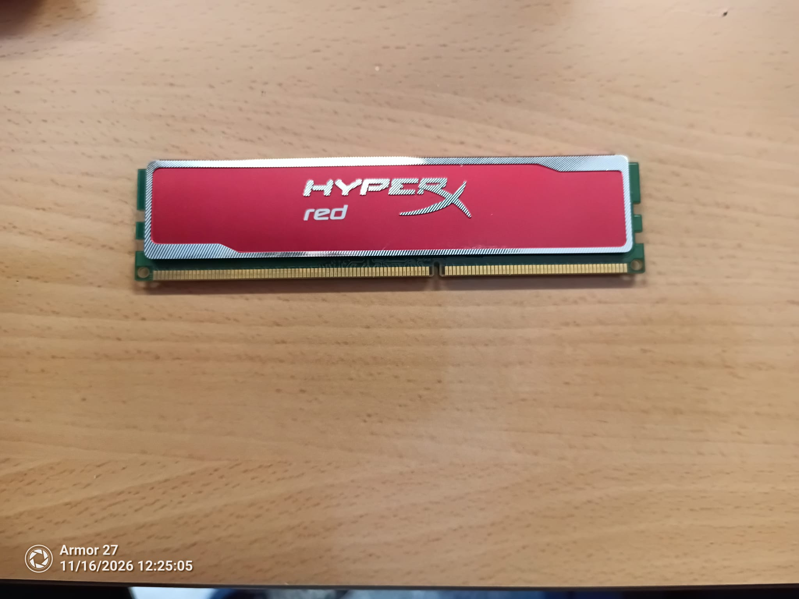 - Para quitar la RAM, le damos a las pestañas y las sacamos|
| Revisión / montaje de almacenamiento | X | ☐ | 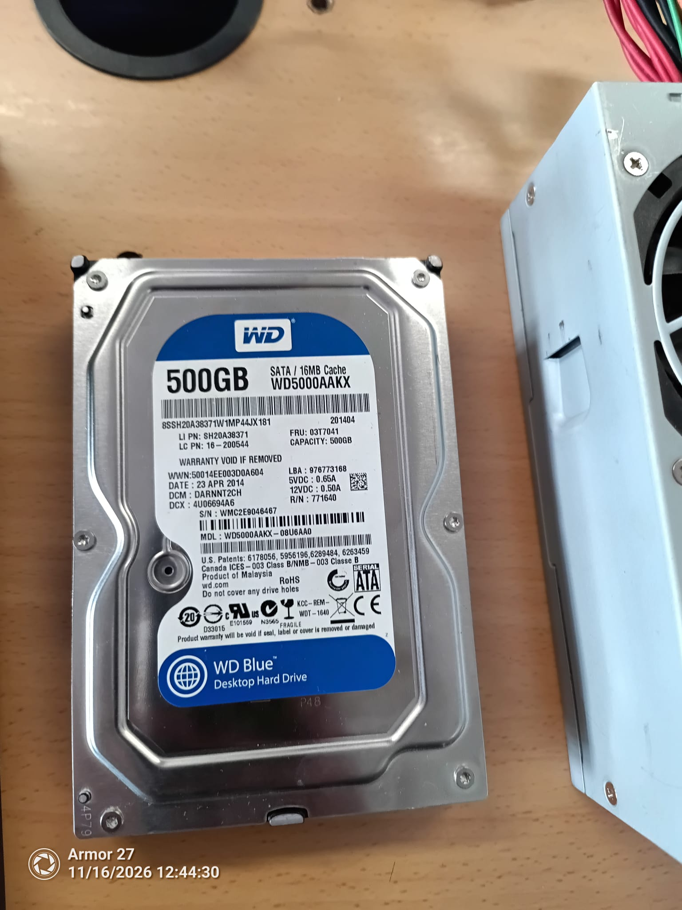 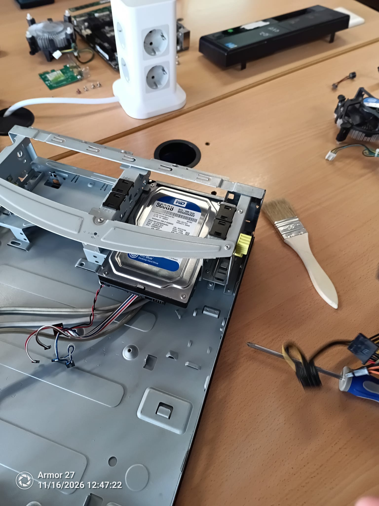 - Quitamos el almacenamiento quitando sus tornillos que lo sujetaban |
| CPU y disipador, si se autoriza | X | ☐ | 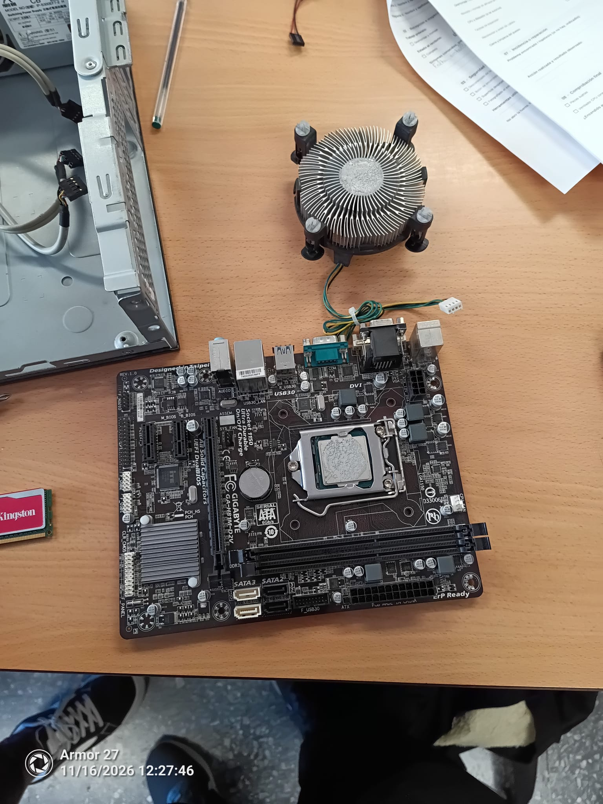 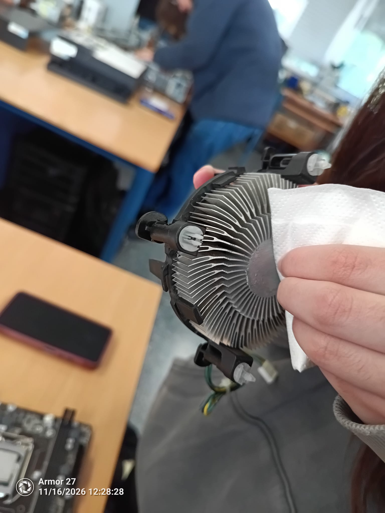 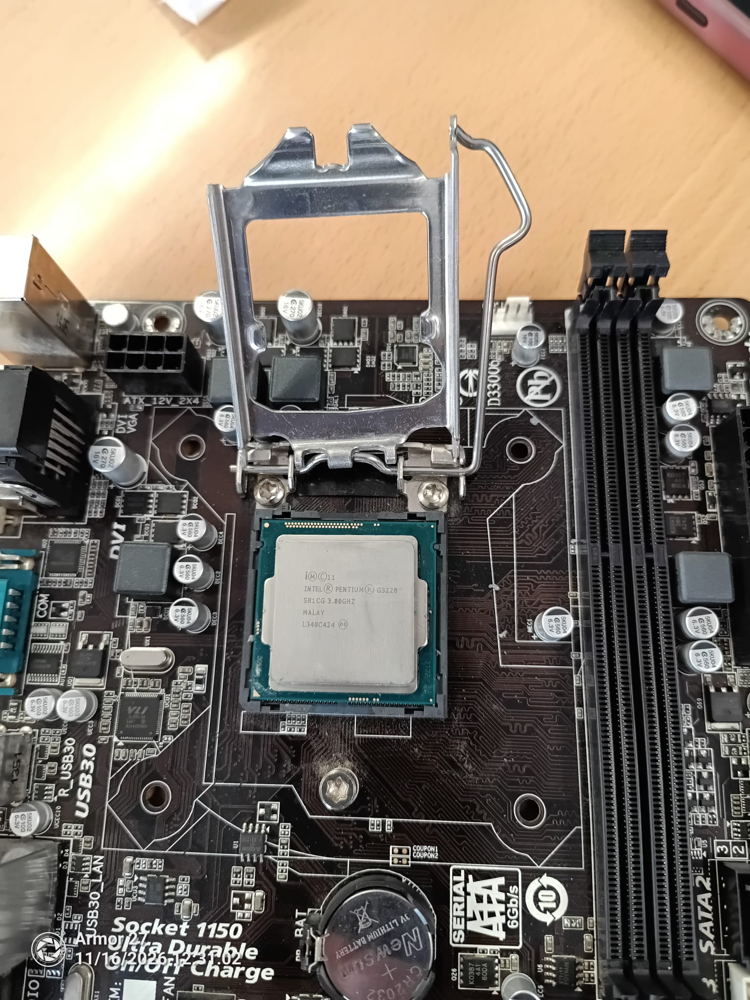 - Quitamos el disipador, moviendo las pestañas, y limpiamos con alcohol isopropílico la pasta térmica del disipador y de la CPU |
| Tarjetas de expansión | ☐ | X | |
| Reconexión y orden de cables | X | ☐ | 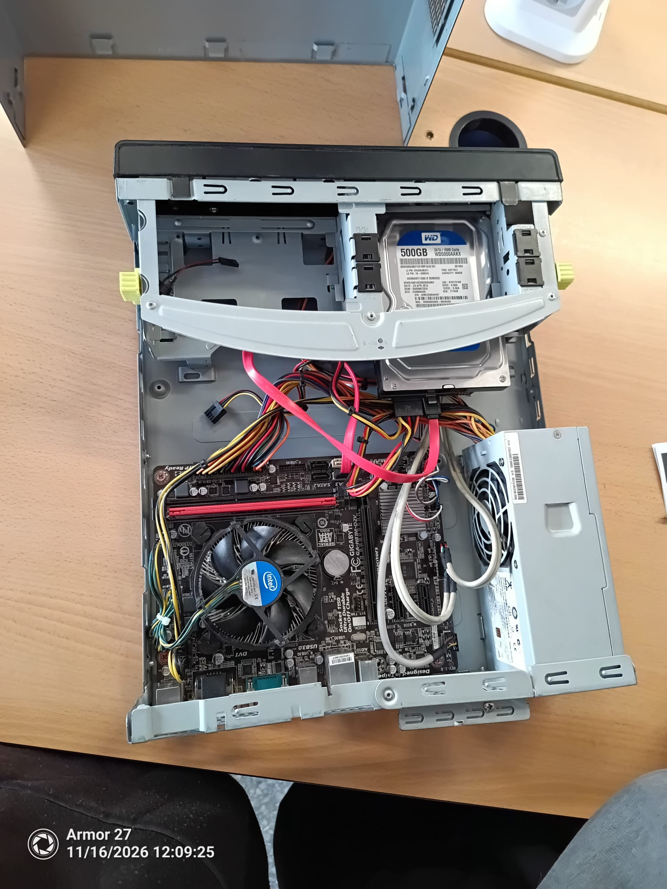 - Volvemos a poner la placa base y organizamos como anteriormente estaban puestas conectadas en la placa base |
| Cierre y limpieza del puesto | X | ☐ | 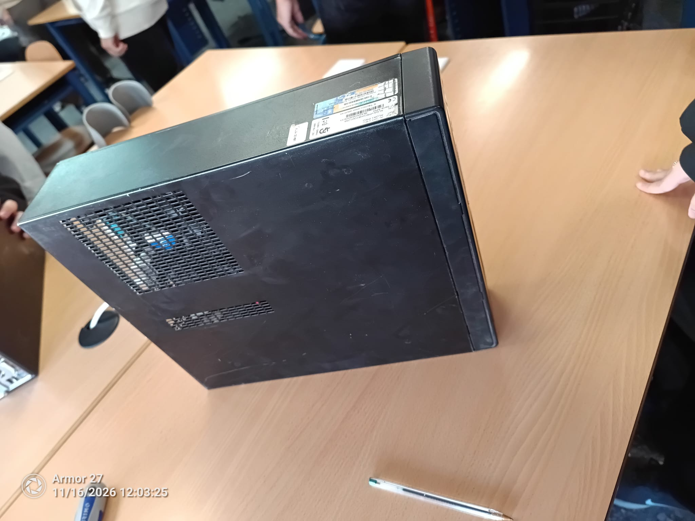 - Ya cerramos la caja y ponemos las herramientas en la caja de herramientas |

## 7. Incidencia o reparación · Equipo A

**Problema encontrado / hipótesis** (si no hay, indicadlo):

- No hemos encontrado ningún error.

**Acción realizada y resultado observado:**

________________________________________________________________________

________________________________________________________________________

________________________________________________________________________

## 8. Comprobación final · Equipo A

- [X] Piezas sujetas.
- [X] RAM encajada.
- [X] Cables revisados.
- [X] Sin tornillos sueltos.
- [X] Ventilador de CPU conectado.
- [X] Puesto recogido.

**¿Encendido autorizado?** ☐ Sí  ☐ No

**Resultado / motivo:** ___________________________________________________

________________________________________________________________________

Una observación no demuestra por sí sola la causa de una avería.

---

## 9. Identificación y arranque · Equipo B

Utilizad vuestro propio ordenador funcional para los siguientes apartados.

**Equipo:** X Portátil  ☐ Sobremesa  ☐ Otro: ___________________________

**Linux:** ☐ Instalado directamente  X Máquina virtual

**Sistema operativo y versión:** El sistema operativo que tengo es Ubuntu y su versión es 26.04

**Si es virtual: sistema anfitrión y programa de virtualización:** WSL2

**¿Arranca con normalidad? ¿Qué observáis desde el encendido hasta el inicio?**

- Sí arranca con normalidad, aunque tarde en arrancar por la RAM asignada. 

- Lo que se observa desde el encendido hasta el inicio es como empieza a cargar el sistema operativo, también al principio me pregunta por si tuviese otra partición el que quiero elegir.

**¿Qué es el POST y en qué se diferencia de la UEFI y del sistema operativo?**

- El POST es un proceso que hace un diagnóstico rápido que lo ejecuta el ordenador nada más que se pulsa el botón de encendido para así comprar que los componentes funcionen correctamente y así que empiece a funcionar.

- La diferencia del POST entre la UEFI y el sistema operativo, es que, el POST es como una tarea, verifica que todo del hardware funcione correctamente, mientras tanto, la UEFI, lo que hace es iniciar el hardware y gestionar sus configuraciones básicas y lanzar el cargador del sistemas, y por último, el sistema operativo, que es el software principal, lo que hace es gestionar los recursos del equipo, ofrecer una interfaz visual y ejecutar aplicaciones.

**¿Habéis accedido a la UEFI o consultado información de ella? ¿Qué dato habéis visto?**

- No he podido acceder a la UEFI de mi máquina virtual.

- He entrado desde mi máquina real, que tengo Windows 11 y se ve cómo se llama mi sistema, las versiones, básicamente, información sobre el sistema.

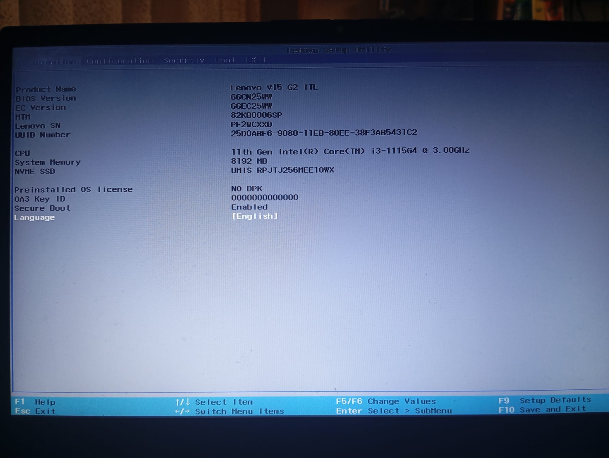

No cambiéis ajustes de UEFI sin indicación del profesor. Si no podéis acceder, indicadlo.

## 10. Linux: procesador · `lscpu`

Ejecutad `lscpu`. Adjuntad la salida revisada o indicad si el comando falla.

**Modelo / CPU presentada a Linux:**  11th Gen Intel(R) Core(TM) i3-1115G4 @ 3.00GHz

**Arquitectura:** x86_64  **CPU lógicas visibles:** 4 

**¿Qué diferencia hay entre núcleo e hilo? ¿Qué podéis concluir de la salida?**

- El núcleo puede ejecutar instrucciones de forma independiente, esto es una unidad física de procesamiento dentro de la CPU, mientras que el hilo, es una unidad lógica de ejecución, es decir que en un núcleo físico se puede gestionar varios hilos simultáneamente.

Linux me detecta 4 CPUS lógicas, que están distribuidas en 2 núcleos y 2 hilos por núcleo.

## 11. Linux: memoria · `free -h`

Adjuntad las salidas de los comandos. Si alguno falla o no está disponible, anotadlo. Antes de entregarlas, ocultad usuarios, nombres de equipo, números de serie y UUID. En una máquina virtual pueden mostrarse recursos virtuales, no el hardware físico completo.

**Memoria total:** 3.7Gi  
**Memoria disponible:** 3.0Gi
**¿Qué significa «disponible» y por qué puede diferir de «libre»?**

- Disponible significa la RAM que se puede utilizar para ejecutar nuevos programas, mientras que libre significa la RAM que está completamente desocupada y no está siendo utilizada por el sistema.

- Se pueden diferir porque Linux utiliza parte de la RAM para almacenar caché con el objetivo de mejorar el rendimiento del sistema.

## 12. Linux: almacenamiento · `lsblk`

**Disco identificado:** Se ha identificado cuatro discos: /dev/sda, /dev/sdb, /dev/sdc y /dev/sdd.

**Partición y punto de montaje, si aparecen:**
- /dev/sdc: 1GB, utilizado como memoria SWAP.
- /dev/sdd: 1TB, montado en / y /mnt/wslg/distro
- /dev/sda y /dev/sdb: no muestran puntos de montaje

**Explicad la diferencia entre disco, partición y punto de montaje:**

- Disco: Es el dispositivo de almacenamiento donde se guardan los datos.
- Partición: Es una división lógica de un disco que permite así organizar el almacenamiento.
- Punto de montaje: Es el directorio del sistema de archivos donde se accede al contenido de una partición.

## 13. Linux: dispositivos · `lspci` y `lsusb`

**Dispositivo 1 y función:** Red Hat, Inc. Virtio 1.0 file system (System peripheral). Es un dispositivo virtual que permite compartir archivos entre el sistema anfitrión (Windows) y la máquina virtual Linux.

**Dispositivo 2 y función:** Microsoft Corporation Basic Render Driver (3D controller). Es una tarjeta gráfica virtual: la VM no accede a la GPU física, sino que usa este adaptador que le presenta el hipervisor para gráficos 3D/aceleración. 

**¿Por qué podría no aparecer un componente físico o mostrarse de otra forma en una máquina virtual?**

- Porque en una máquina virtual el hipervisor no entrega el hardware real, sino dispositivos emulados. Por eso componentes físicos como el chipset de la placa base, la tarjeta gráfica real o los puertos USB pueden no aparecer, o salir con otro nombre (por ejemplo, la GPU como "Basic Render Driver"). Además, el anfitrión decide qué dispositivos se exponen al invitado.

## 14. Duda técnica y uso crítico de IA

Podéis usar una IA de Internet. No compartáis datos personales ni información privada del centro. Sin acceso a IA, resolved la duda con una fuente técnica.

**Herramienta utilizada y fecha:** Claude y ChatGPT / 20/11/2026

**Pregunta planteada:**

- En mi Ubuntu (máquina virtual/WSL), lsusb no muestra ningún dispositivo, aunque tengo ratón y teclado USB conectados al equipo anfitrión. ¿Por qué ocurre y cómo podría hacer que aparezcan?

**Respuesta resumida y afirmación concreta que decidisteis comprobar:**

- La IA explicó que la VM no tiene acceso directo a los puertos USB del anfitrión, porque el hipervisor solo le presenta dispositivos virtuales. Para ver un USB hay que redirigirlo expresamente.

**Fuente técnica o prueba utilizada y resultado:** confirmada / corregida / no verificada.

- Ejecuté lsusb y vi que no devolvía nada, así que consulte por internet lo que debería mostrar una lista de todos los buses USB y los dispositivos conectados a ellos.

## 15. Valoración y entrega

**¿Qué paso fue más difícil y cómo lo resolvisteis?**

- Fue a la hora de utilizar el comando lscpu, ya que tuve que buscarlo correctamente, y los comandos lspci y lsusb porque había que instalar algo aparte y con el lsusb porque no me mostraba nada.

**¿Qué relación existe entre el montaje y la información de Linux? Recordad que son equipos distintos.**

- El montaje se hizo sobre un portátil físico, mientras que la información de Linux sale por una máquina virtual.

**¿Qué haríais de otra manera en un próximo montaje?**

- A la próxima que haría un montaje sería comprobar si todos los componentes son compatibles entre ellos y que funcionará correctamente. Aparte preparar el sitio de trabajo, haría fotos a los cables del panel frontal y también de las demás conexiones. Por último lo que haría sería antes de cerrar el equipo encenderlo y comprobar que funcione el equipo correctamente, ya si funcionase bien lo cerraría y ya estaría preparado para funcionar.

Antes de entregar:

- [X] Ficha completa.
- [X] Fotos identificadas.
- [X] Salidas de Linux revisadas.
