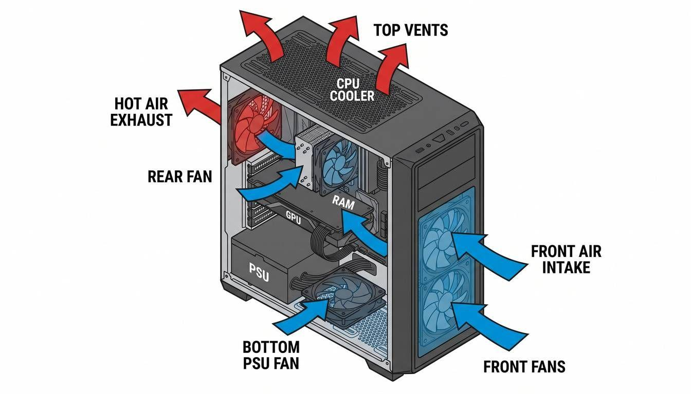

# Puzzle - Pieza 10: Caja y refrigeración

## Resumen

- La energía que consume un ordenador, casi toda, acaba generándose como calor, sobre todos los componentes como la CPU, la GPU y las memorias. La refrigeración lo que hace es evitar que los componentes superen la temperatura máxima. Si falla, el procesador baja su velocidad y, en casos extremos, el equipo se apaga. 

### Piezas del sistema

- **Caja (Chasis):** Protege los componentes y tiene rejillas y huecos para ventiladores: entra aire frío y sale el caliente.

- **Disipador:** Bloque metálico con aletas (y heatpipes) que reparte el calor del chip hacia el aire.

- **Pasta térmica:** Rellena los huecos microscópicos entre CPU y disipador. Basta una capa muy fina.

- **Ventiladores:** Mueven el aire por el disipador y por la caja.

- **AIO:** Un líquido recoge el calor en una placa fría, lo lleva por tubos y lo traspasa en un radiador con ventiladores.

### Cómo funciona, cuatro pasos

- 1. **Conducción:** El calor pasa del chip al metal a través de la pasta térmica.

- 2. **Transporte:** Heatpipes (aire) o bomba (AIO) llevan el calor a las aletas o al radiador.

- 3. **Convección forzada:** Los ventiladores hacen pasar aire por las aletas o el radiador.

- 4. **Expulsión:** El aire caliente tiene que salir de la caja, ya que, si no sale, sube la temperatura de todo.

- Si hay mal contacto, poco flujo o poca salida de aire, eso decidirá la temperatura de todo.

| Tipo | Ventaja | Inconveniente |
|---|---|---|
| Disipador de aire | Duradero, barato, sin fugas | Grande y pesado, puede chocar con la RAM |
| AIO | Buen rendimiento con CPU potentes | La bomba puede fallar y es más cara |
| Pasiva | Silencio total | Solo vale si no haces mucho con la CPU |
| Circuito a medida | Máximo enfriamiento | Muy cara, mantenimiento y riesgo de fugas |

### Elegir e instalar

- **Presión estática o caudal:** En un radiador importa la presión estática, que empuja el aire contra las aletas, en la caja, el caudal.

- **PWM:** Los ventiladores de 4 pines regulan su velocidad con una señal PWM, los de 3 pines, por tensión.

- **Presión positiva:** Entra más aire del que sale, y así entra menos polvo.

- **Errores típicos:** Apretar el soporte de forma desigual, poner demasiada pasta y dejar cables que bloqueen el aire.

### Modelo comercial

- Arctic Liquid Freezer III 360 A-RGB, con un radiador de 360 mm y tres ventiladores de 120 mm PWM. Al ser grueso, hay que comprobar que no choque con la RAM.

## Tipo test

1. ¿Para qué sirve la pasta térmica entre la CPU y el disipador?

    - A) Para pegar el disipador a la CPU 
    - B) Para aislar la CPU del calor
    - C) Para rellenar los huecos microscópicos y mejorar el paso del calor <- **Correcta**
    - D) Para enfriar el aire que entra en la caja

    - **Explicación:** Las superficies metálicas parecen lisas pero tienen huecos diminutos con aire, lo que hace una mala conducción del calor. La pasta lo que hace es rellenarlos, no pega ni aisla.

2. ¿Qué parámetro es el más importante al elegir un ventilador para un radiador?

    - A) El color de la iluminación
    - B) La presión estática <- **Correcta**
    - C) Solo las RPM máximas
    - D) El número de cables

    - **Explicación:** El radiador tiene aletas muy juntas y ofrece mucha resistencia. Hace falta un ventilador que empuja aire con fuerza, la presión estática, no solo que mueva aire al aire libre.

3. La CPU llega a 90ºC pocos segundos después de encender. ¿Cuál es la causa más probable?

    - A) Poco flujo de aire en la caja
    - B) Mal contacto entre la CPU y el disipador o la placa fría <- **Correcta**
    - C) Polvo acumulado durante años
    - D) Un ventilador de la caja demasiado silencioso

    - **Explicación:** Una subida tan rápida indica que el calor no pasa de la CPU al metal. El poco flujo de aire provoca una temperatura alta pero estable, y el polvo tarda en acumularse.

4. ¿Qué significa tener presión positiva en la caja?

    - A) Que sale menos aire del que entra, y entra más polvo
    - B) Que entra más aire del que sale, y entra más polvo
    - C) Que la caja está sellada
    - D) Que entra más aire del que sale, y entra menos polvo <- **Correcta**

    - **Explicación:** Con presión positiva el aire se escapa por las rendijas y no entra por ellas, así que entra menos polvo. La presión negativa es lo contrario.

5. ¿Qué error se comete al conectar la bomba de una AIO a un conector regulado por temperatura?

    - A) Que la bomba puede bajar de velocidad y el líquido no circula bien <- **Correcta**
    - B) Que la CPU no arranca
    - C) Que la RAM no se detecta
    - D) Que el radiador cambia de tamaño

    - **Explicación:** La bomba debe girar siempre para mover el líquido. Si la placa la frena porque hace poco calor, el calor no se transporta cuando hace falta.

## Uso de IA

- Se utilizó la IA para poder resumir mejor la pieza con los md README y teoría, nosotras lo hemos revisado y cambiado algunas partes.

## Fuentes

- https://www.guru3d.com/review/arctic-liquid-freezer-iii-360-argb-cooler-review/page-2/

- https://www.corsair.com/lm/es/explorer/diy-builder/blogs/positive-pressure-vs-negative-pressure-which-is-best-for-a-gaming-pc/

- https://www.profesionalreview.com/2024/08/25/ventiladores-3-pines-vs-4-pines/amp/
