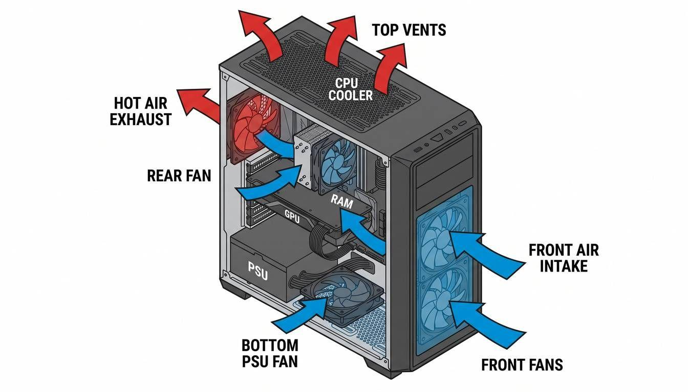
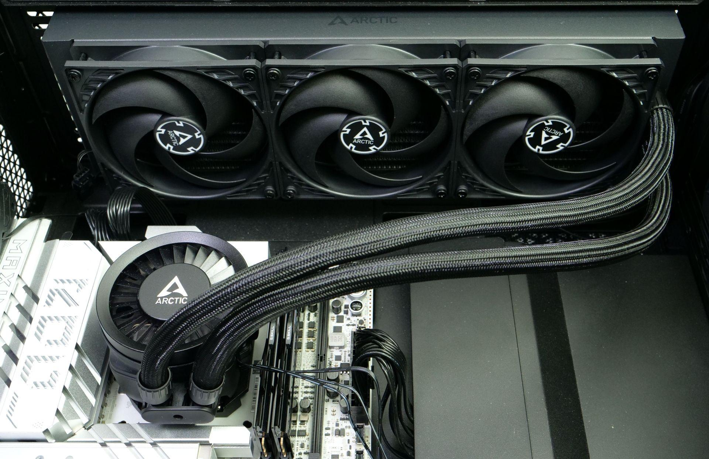
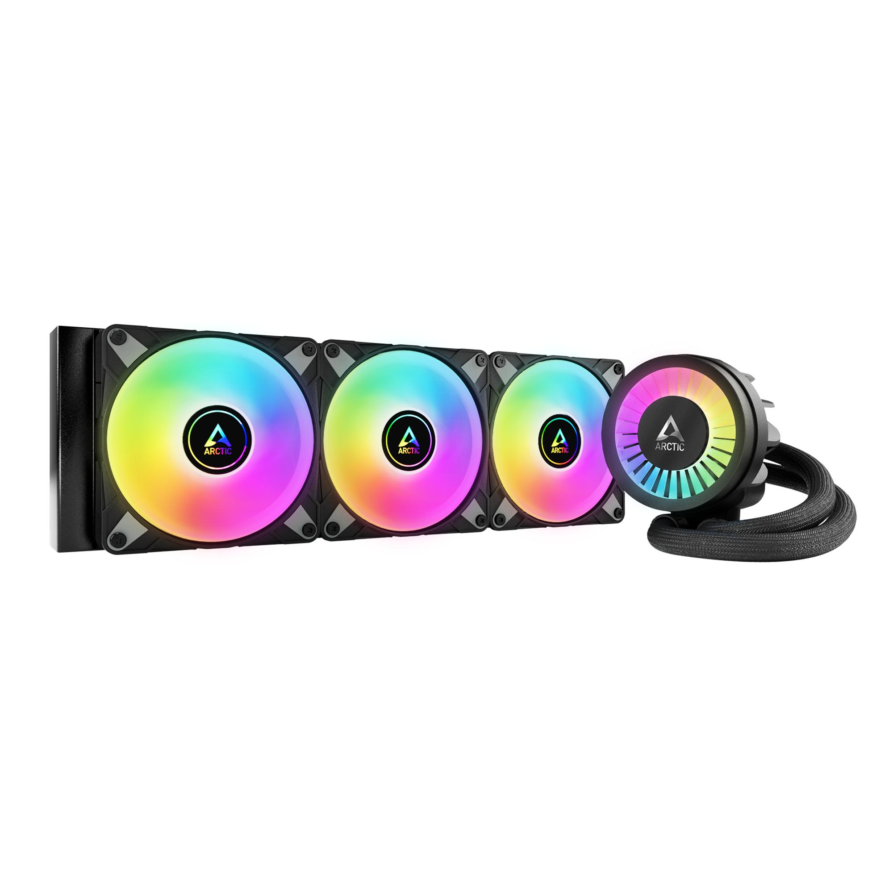

# Teoría · Pieza 10: Caja y refrigeración

**Grupo:** Sheila Muñoz · Loli Joya

> Máximo 1 folio por las dos caras. Es lo que estudiará toda la clase para el test: claro, exacto y sin relleno.

## Conceptos clave

- **Calor:** el ordenador genera mucho calor, sobre todo en la CPU, la GPU y las memorias. Toda la energía que consume se convierte en calor.
- **Refrigeración:** su función es que ningún componente supere su temperatura máxima de trabajo.
- **Qué pasa si falla:** el procesador se calienta demasiado, el ordenador va más lento para enfriarse y, si la temperatura sigue subiendo, se apaga.
- **Caja (chasis):** es donde van todos los componentes. Además de proteger las piezas, tiene huecos para los ventiladores y rejillas para que entre aire más frío y salga el caliente.
- **Disipador:** bloque de metal con muchas láminas, que también se llaman aletas. Recoge el calor del chip y lo reparte por las láminas, que están en contacto con el aire.
- **Heatpipes (tubos de calor):** tubos con un fluido que se evapora y se condensa. Llevan el calor a las aletas.
- **Pasta térmica:** crema que se pone entre la CPU y el disipador. Sin ella solo queda aire entre los dos, y el aire deja pasar mal el calor. La pasta rellena ese hueco, y basta una capa fina, como un grano de arroz.
- **Ventiladores:** empujan aire por las láminas del disipador y por dentro de la caja. Así se va el aire caliente y entra el frío.
- **Refrigeración líquida (AIO):** usa un líquido en vez de aire. Pasa por una placa que toca el procesador, se lleva el calor por unos tubos y lo suelta en un radiador, que enfrían unos ventiladores.
- **Flujo de aire en la caja:** lo habitual es que entre aire fresco por el frontal y la parte baja, y que salga por la parte trasera y la superior, porque el aire caliente sube.
- **Presión positiva y negativa:** es positiva cuando entra más aire del que sale, y deja entrar menos polvo. Es negativa en el caso contrario.
- **Efecto horno:** ocurre al poner todos los ventiladores metiendo o sacando aire, sin dejar una vía de escape fluida.

## Tabla resumen

| Tipo | Dato clave | Cuándo se usa |
|---|---|---|
| Disipador de aire | Cobre en contacto con el chip, heatpipes y aletas con ventilador | Alta durabilidad y precio contenido, sin bomba ni riesgo de fugas; es grande y pesado y puede chocar con la RAM o la tapa de la caja |
| AIO (líquida compacta, 120 a 420 mm) | Placa fría, bomba y radiador; el líquido transporta el calor lejos del socket | Rinde muy bien con CPU de mucha potencia y deja libre el espacio del socket; la bomba puede fallar, es más cara y necesita un hueco para el radiador |
| Pasivo (sin ventilador) | Depende solo de las aletas del disipador y del flujo de aire de la caja | Silencio absoluto al no tener partes móviles; solo es eficaz con CPU de muy bajo consumo |
| Circuito líquido a medida | Bomba, depósito y radiadores montados pieza a pieza | Máximo enfriamiento y gran estética; coste muy elevado, mantenimiento constante y riesgo de fugas |

## Datos que hay que saberse

### Cómo funciona

El calor viaja del chip al aire de la habitación en cuatro pasos:

1. **Conducción:** el chip pasa su calor al metal del disipador o de la placa fría a través de la pasta térmica. Es el paso más sensible a un mal montaje.
2. **Transporte:** en un disipador de aire, los heatpipes llevan el calor a las aletas. En una AIO, la bomba hace circular el líquido hasta el radiador.
3. **Convección forzada:** los ventiladores empujan aire por las aletas o por el radiador, y ese aire se lleva el calor.
4. **Expulsión:** el aire caliente tiene que salir de la caja. Si se queda dentro, sube la temperatura de todo lo demás, incluido el aire que entra al disipador.

Los dos caminos, por aire y por líquido, acaban en el mismo sitio. 

### Flujo de aire dentro de una caja de PC

El aire frío entra por los ventiladores frontales y el ventilador inferior de la fuente de alimentación. El aire caliente sale por el ventilador trasero y por las rejillas superiores.

### Características, unidades y cómo se miden

La refrigeración se compra por tres cosas: cuántos vatios es capaz de retirar, cuántos grados sube el chip por encima del ambiente y cuánto ruido hace al conseguirlo.

| Magnitud | Unidad | Qué indica | Cómo se mide |
|---|---|---|---|
| TDP (Thermal Design Power) | W | Potencia térmica de referencia con la que el fabricante de CPU pide dimensionar el disipador | No se mide: es un dato que da el fabricante en la ficha |
| PBP y MTP | W | Potencia base sostenida y potencia máxima en turbo | Tampoco se miden: los da Intel en la ficha |
| PPT | W | Límite real de potencia del paquete | Se consulta en la BIOS o en Ryzen Master de AMD |
| Temperatura de la CPU | °C | Estado térmico actual; el fabricante fija un máximo | La miden sensores dentro del propio chip y se lee en la BIOS |
| Resistencia térmica | °C/W | Grados que sube el chip por cada vatio disipado; menos es mejor | No se lee: se calcula como (temperatura del chip − temperatura ambiente) ÷ potencia en vatios |
| Velocidad de giro | RPM | Vueltas por minuto del ventilador | El ventilador envía una señal a la placa base, que cuenta las vueltas; se ve en la BIOS o en un programa de control de ventiladores |
| Ciclo de trabajo PWM | % | Fracción del tiempo que la señal está activa; fija la velocidad del ventilador | Lo genera la placa base y se ajusta desde la BIOS o un programa; a mayor porcentaje, más rápido gira |
| Dimensiones | mm | Altura del disipador y tamaño y grosor del radiador; decide si cabe en la caja | Con una regla o con la ficha del fabricante, y se compara con las medidas máximas de la caja |

### Modelo comercial: Arctic Liquid Freezer III 360 A-RGB

| Dato | Valor |
|---|---|
| Fabricante | Arctic |
| Modelo | Liquid Freezer III 360 A-RGB |
| Sockets compatibles | AMD: AM5 y AM4. Intel: LGA1851 y LGA1700 |
| Ventilador | 3 × Arctic P12 PWM A-RGB de 120 × 25 mm |
| Velocidad del ventilador | 200 a 2000 RPM |
| Caudal de aire | 48,82 CFM |
| Presión estática | 1,85 mmH₂O |
| Ventilador de VRM | 400 a 2500 RPM (controlado por PWM) |
| Bomba | 800 a 2800 RPM (regulable por PWM) |
| Consumo de la bomba | Hasta 4,2 W (0,35 A × 12 V) |
| Radiador | 398 × 120 × 38 mm |

### Averías típicas

La mayoría de los problemas de refrigeración no son piezas rotas, sino mal contacto, mala conexión o mal flujo de aire. Antes de cambiar nada conviene mirar en la BIOS la temperatura y las RPM de ventiladores y bomba.

| Síntoma | Causa más probable | Cómo se comprueba o se evita |
|---|---|---|
| La CPU salta a 90 °C o más en segundos de carga | Contacto: film de plástico sin retirar, soporte mal apretado o montado al revés, o falta o exceso de pasta | Reinstalar con presión uniforme. En la Liquid Freezer III, un soporte AMD girado cubre solo la parte alta de la CPU |
| La temperatura sube despacio y se estabiliza muy alta | Poco flujo de aire: filtros con polvo, radiador atascado o caja sin salida de aire | Limpiar filtros y radiador, y comprobar que el aire entra y sale |
| Temperaturas peores tras años de uso | Pasta térmica reseca | Quitar la vieja con alcohol isopropílico y aplicar pasta nueva |
| Ventilador ruidoso o que no gira | Rodamiento desgastado, acumulación de polvo o cable rozando las aspas | Revisar el cable y limpiar; si hay vibración o chirrido, sustituirlo |
| Ventilador que no sigue la curva de la BIOS | Conector de 3 pines (control por voltaje) con un ventilador de 4 pines, o modo PWM/DC mal elegido en la BIOS | Fijar el modo correcto en la BIOS y usar el conector adecuado |
| Aviso de error de ventilador de CPU al arrancar | Bomba o ventilador en el conector equivocado, o RPM por debajo del mínimo que acepta la placa base | Conectar la bomba al conector de bomba o de AIO; no dejarla en 0 RPM |
| Gorgoteo y subida de temperatura en una AIO | Aire acumulado en la bomba al montar el radiador con la bomba en el punto más alto del circuito | Montar con el radiador más alto que la bomba |
| AIO que rinde peor con los años | Evaporación lenta del líquido a través de los tubos y desgaste de la bomba | Vigilar las RPM de la bomba y las temperaturas; las AIO tienen vida limitada |
| La iluminación o un ventilador dejan de funcionar | Mezcla de conexiones A-RGB de 5 V con RGB de 12 V, o 12 V conectados al pin de control del PWM | Respetar la tensión específica de cada conector |

### Errores al elegir

- **Subestimar el calor:** guiarse solo por el TDP de la caja y no por la potencia real.
- **Problemas de espacio:** comprar disipadores o radiadores sin medir si chocan con la caja, la RAM o la gráfica.
- **Incompatibilidad física:** no revisar el socket ni los disipadores M.2 que estorban.
- **Peligro con metal líquido:** usarlo sobre aluminio o cerca de circuitos expuestos.
- **Mal ventilador para radiador:** mirar el caudal de aire en lugar de la presión estática.

### Errores al instalar

- **Presión desigual:** apretar el soporte de golpe y en diagonal, en lugar de hacerlo de forma gradual y cruzada.
- **Exceso de pasta térmica:** aplicar demasiada cantidad.
- **Efecto horno:** configurar todos los ventiladores metiendo o sacando aire, sin dejar una vía de escape fluida.
- **Obstrucción física:** dejar cables sueltos que frenen el flujo de aire o choquen con las aspas.
- **Bomba capada:** conectar la AIO a un conector regulado por la temperatura de la CPU, lo que reduce mucho sus RPM.

## Preguntas tipo test (8)

1. ¿Qué función cumple la pasta térmica?
   - a) Enfriar la CPU con líquidos.
   - b) Rellenar el hueco de aire entre CPU y disipador.  ← correcta
   - c) Eliminar los ventiladores.
   - d) Proteger la caja del polvo.
   - Explicación: Entre la CPU y el disipador quedan huecos microscópicos llenos de aire, y el aire conduce muy mal el calor. La pasta los rellena y mejora la transferencia. No enfría por sí sola (A), no sustituye a los ventiladores (C) y no tiene nada que ver con el polvo (D)

2. ¿Qué indica el PPT?
    - a) Las RPM de la bomba.
    - b) La temperatura de la CPU.
    - c) El límite real de potencia del procesador. <- Correcta
    - d) La resistencia térmica.
    - Explicación: El PPT (Package Power Tracking) es el límite real de potencia del procesador, en W, y se ve en la BIOS o en Ryzen Master, el programa de AMD. La A habla de RPM, que son de los ventiladores y la bomba. La B es la temperatura, que se mide en °C. La D es la resistencia térmica (°C/W).

3. ¿Qué inconveniente tiene un disipador de aire?

    - a) Tiene riesgo de fugas.
    - b) Necesita una bomba.
    - c) Es grande y puede chocar con la RAM. <- Correcta
    - d) Requiere mantenimiento constante.
    - Explicación: Su desventaja es el tamaño y el peso, que pueden chocar con la RAM o con la tapa de la caja. La A es un problema de las AIO y de los circuitos a medida, porque el aire no lleva líquido. La B es falsa: el disipador de aire no lleva bomba, solo ventilador. La D es falsa porque no necesita mantenimiento constante.

4. ¿Qué parámetro es importante en un ventilador de radiador?
    - a) La presión estática. <- Correcta
    - b) El color.
    - c) El tamaño de la caja.
    - d) La temperatura ambiente.
    - Explicación: Un radiador tiene muchas aletas muy juntas que frenan el aire, y para empujarlo a través hace falta presión estática. El caudal importa más en espacios abiertos, y elegir por caudal es justo el error que se señala en "errores al elegir". La B, la C y la D no influyen en el rendimiento del radiador.

5. ¿Qué realiza el transporte en una AIO?

    - a) La bomba mueve el líquido hasta el radiador. <- Correcta
    - b) Los ventiladores expulsan el aire de la habitación.
    - c) El chip transmite el calor al disipador.
    - d) La caja elimina el polvo.
    - Explicación: El paso 2 del funcionamiento es el transporte, y en una AIO lo hace la bomba moviendo el líquido hasta el radiador. La B es la expulsión (paso 4). La C es la conducción (paso 1). La D no es un paso del funcionamiento.

6. Si la CPU llega a 90 ºC en segundos, ¿cuál puede ser la causa?
    - a) Presión positiva.
    - b) Mal contaco entre CPU y disipador. <- Correcta
    - c) Polvo en los filtros.
    - d) Evaporación lenta del líquido.
    - Explicación: Una subida tan rápida indica que el calor no pasa del chip al disipador, es decir, falla la conducción. La A no es una causa: la presión positiva incluso reduce el polvo. La C (poco flujo de aire) hace que la temperatura suba despacio y se estabilice alta. La D ocurre con los años, no en segundos.

7. ¿Qué velocidad alcanza la bomba del Arctic Liquid Freezer III 360?
    - a) 200-2000 RPM.
    - b) 400-2500 RPM.
    - c) 800-2800 RPM. <- Correcta
    - d) 3000 RPM fijas.
    - Explicación: Es el dato de la ficha técnica. La A corresponde a los ventiladores P12 (200–2000 RPM) y la B al ventilador de VRM (400–2500 RPM). La D es falsa porque la bomba es regulable por PWM. 

8. ¿Qué puede ocurrir al conectar 12 V al pin de control de un ventilador PWM?
    - a) Aumenta el caudal de forma segura.
    - b) Se estropea inmediatamente. <- Correcta
    - c) Reduce el ruido.
    - d) Mejora la refrigeración.
    - Explicación: El pin de control del PWM solo admite una señal de baja tensión. Meterle 12 V o 24 V daña el ventilador al instante, como advierte Noctua en su documento técnico. Las otras opciones son falsas: no aumenta el caudal, ni reduce el ruido, ni mejora la refrigeración. 

